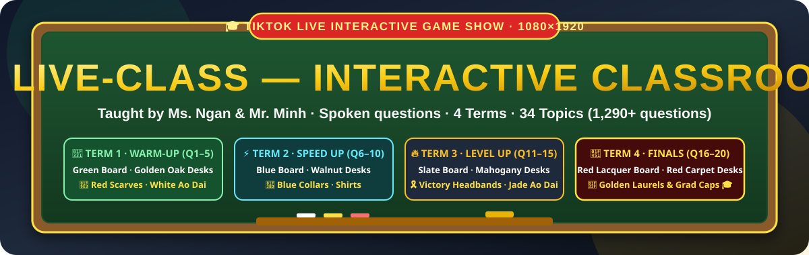

<div align="center">



# 🏫 LIVE-CLASS — Interactive Classroom Game Show (English edition)

**A live classroom quiz show in portrait 9:16 (`1080×1920`) where viewers become students, type answers in the comments and climb from Grade 1 to Graduation 🎓 with Ms. Ngan and Mr. Minh.**

Original game by **[Duong Birken](https://duongbirken.deta.vn)** · English edition: full English UI, teacher script and question banks.

</div>

---

## Two ways to run it

| | **A. Single HTML file (no server)** | **B. TikTok LIVE mode (Node server)** |
| :-- | :-- | :-- |
| What | One file you paste into **Blogger**, WordPress, GitHub Pages or open locally | The original TikTok LIVE setup: real comments, gifts, likes and follows from your live |
| Players | You type in the comment box, plus simulated classmates (0–30) | Your TikTok viewers |
| Voice | The browser's built-in English voices (free) | Microsoft Edge English voices (free, internet needed) |
| Saves | Scores, report cards and asked questions in the browser (localStorage) | `data/class-book.json` on your PC |
| File | `dist-standalone/live-class-en.html` | `npm install` then `START-LIVE.bat` / `npm run dev` |

### A. Single HTML (Blogger)

1. Open `dist-standalone/live-class-en.html`, copy **everything**.
2. In Blogger: *New post → HTML view* → paste → Publish.
3. Open the post, press **▶ Start class** (browsers only allow sound after a tap).

Images load from this public GitHub repo through jsDelivr (with a raw.githubusercontent.com fallback), so the HTML stays small. To host the images yourself, add before the pasted block:

```html
<script>window.LIVE_CLASS_ASSETS = 'https://your-host/path/to/public';</script>
```

`dist-standalone/index.html` is the same game as a complete web page (for GitHub Pages, Netlify, Cloudflare Pages, or double-clicking locally).

`dist-standalone/live-class-en-offline.html` has every image built in (~3 MB, no CDN needed). It is usually too big for a Blogger post, so host it as its own page (Cloudflare Pages, GitHub Pages, Netlify) or open it locally.

**Phones:** the stage and the answer box are sized to fit the screen together, and while the keyboard is open the current question (letters, clue, sum, A–D options) and the time left are repeated right above the answer box. Tested on 280–480 px wide phones, landscape and tablets. The ⛶ button gives a full-screen view with the answer box underneath.

Rebuild after editing: `node tools/build-standalone.mjs` (needs `esbuild`, `tailwindcss` and `react`, all installed by `npm install`).

### B. TikTok LIVE Studio

```powershell
npm install
npm run dev          # or double-click START-LIVE.bat
```

- Control panel: `http://localhost:3006` — connect your `@username`, pick the voice, test buttons.
- Add a **Browser source** in TikTok LIVE Studio / OBS: `http://lvh.me:3006/?view=stage`, size **1080 × 1920**.
- After the live: `http://localhost:3006/report` shows the session report.

---

## How to play (what viewers type)

| Moment | Type |
| :-- | :-- |
| Join the class | anything, or `join class` (the teacher greets you) |
| Word / emoji / spelling / riddle / history question | the answer word (fastest 5: **+10 / +7 / +5 / +3 / +3**, later correct answers +1, question 20 is golden ×2) |
| Mental math | the number |
| Team picking | `team 1` … `team 4` (also `t2`, `3`, `team three`) |
| Topic vote / Pick a side | `1` or `2` |
| Rock paper scissors | `rock`, `paper` or `scissors` |
| Roll call | `here` (or `present`) |
| Big shows (Road to Everest, Golden Bell) | `A`, `B`, `C` or `D` · bets `10` / `20` · ticket `hint` · password word |
| Fun polls | the single letter the teacher asks for |
| Your lifetime report card | `report card` |
| Birthday | `it's my birthday` |

Each class: 20 questions — 5 scrambled words, 5 emoji puzzles, 4 mental math, 2 spelling, 2 history, 2 riddles in a row. Between classes: recess games (rock-paper-scissors, pop quiz, pick a side, roll call, heart challenge, dance), a topic vote, and every few classes a big show.

---

## Customizing

- **Questions:** `src/game/word-bank/*.txt` (34 topic files) — one question per line:
  ```text
  ANSWER | clue | difficulty 1-3 | other accepted answers, comma separated
  ```
  A line starting with `>` is the type the teacher reads ("This is an animal."). File-name endings put a file in a special slot: `-meo` riddles, `-su` history, `-anh` spelling, `-dh` emoji puzzles (the clue column is the emoji).
- **Big shows:** `src/game/show-bank/multiple-choice.txt` (multiple choice, right answer first) and `passwords.txt` (passwords with 3 clues).
- **Teacher lines:** `src/game/lines.ts` (every situation has several lines, dealt like a shuffled deck).
- **Numbers & rules:** `src/game/config.ts` (timers, points, seats, outfits, show schedule).
- Check everything: `npx tsx src/game/bank.check.ts` and `npx tsx src/game/quiz.check.ts`.

---

## Project structure

```text
src/
  game/        game core (quiz.ts), stage (GameStage.tsx), teacher script, questions, config, sound effects
  live/        events, voice queue, names, banned words, control panel (server mode)
  standalone/  single-file edition: in-browser "server", browser voice, simulated classmates, app shell
public/assets/ character sprites and classroom background (.webp)
server.ts      Express + TikTok LIVE connector + TTS (server mode)
tools/build-standalone.mjs   builds dist-standalone/
```

<div align="center">

### 💖 Credits

LIVE-CLASS is part of the **Interactive TikTok LIVE Games** by **[Duong Birken](https://duongbirken.deta.vn)** — 👉 **[https://duongbirken.deta.vn](https://duongbirken.deta.vn)** 👈

Code: MIT (see LICENSE). Character art and backgrounds belong to their author.

</div>
